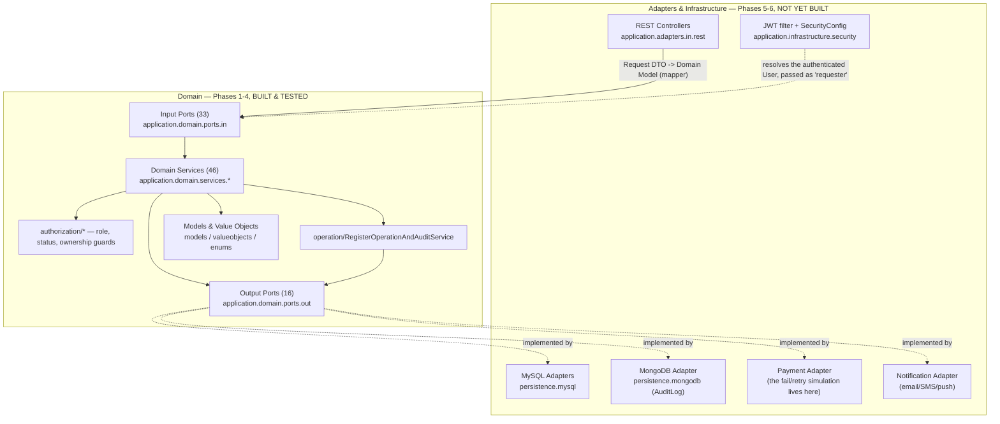
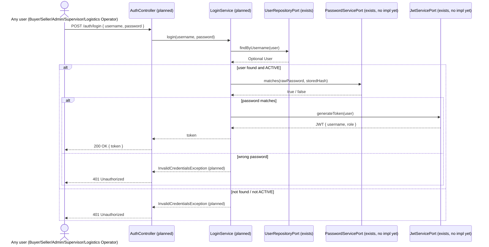
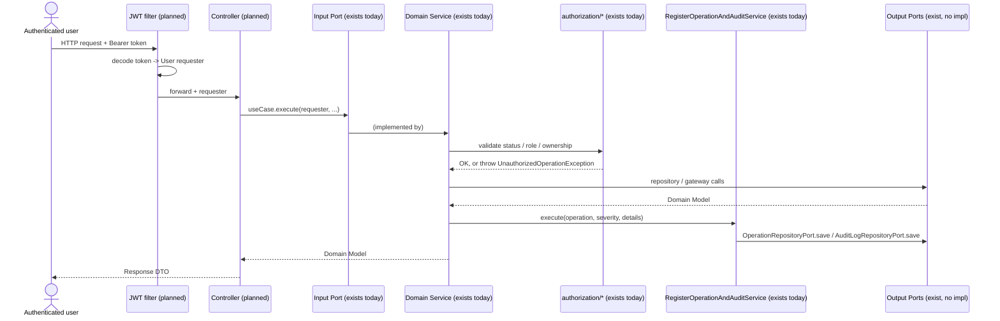
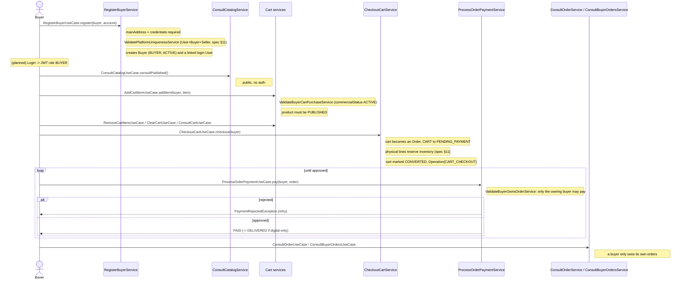
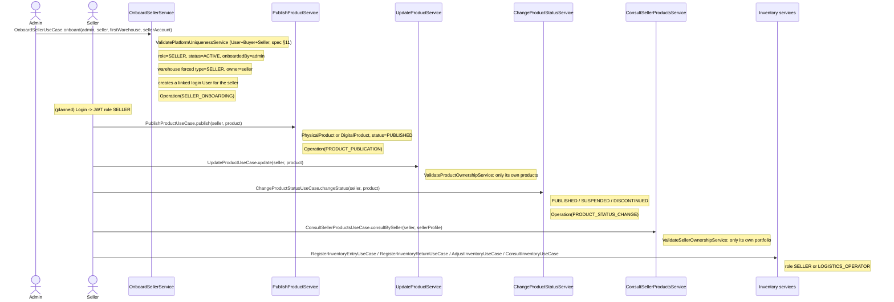
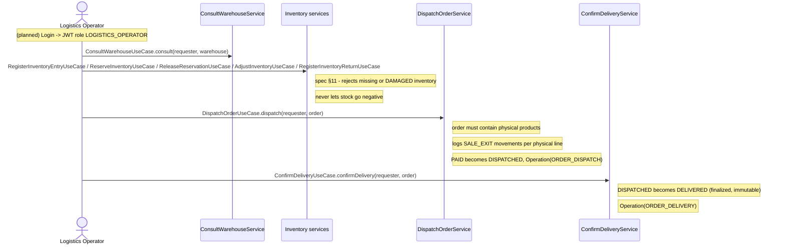
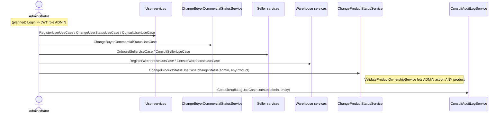
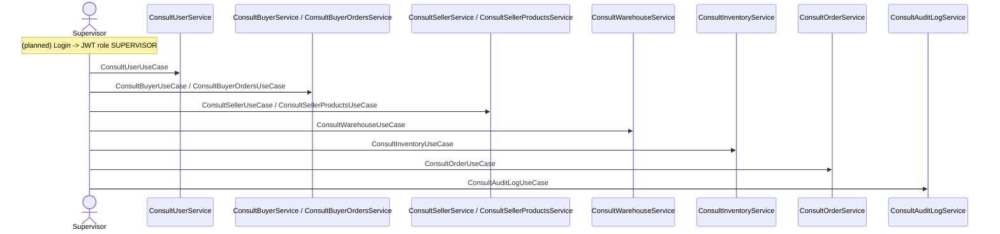
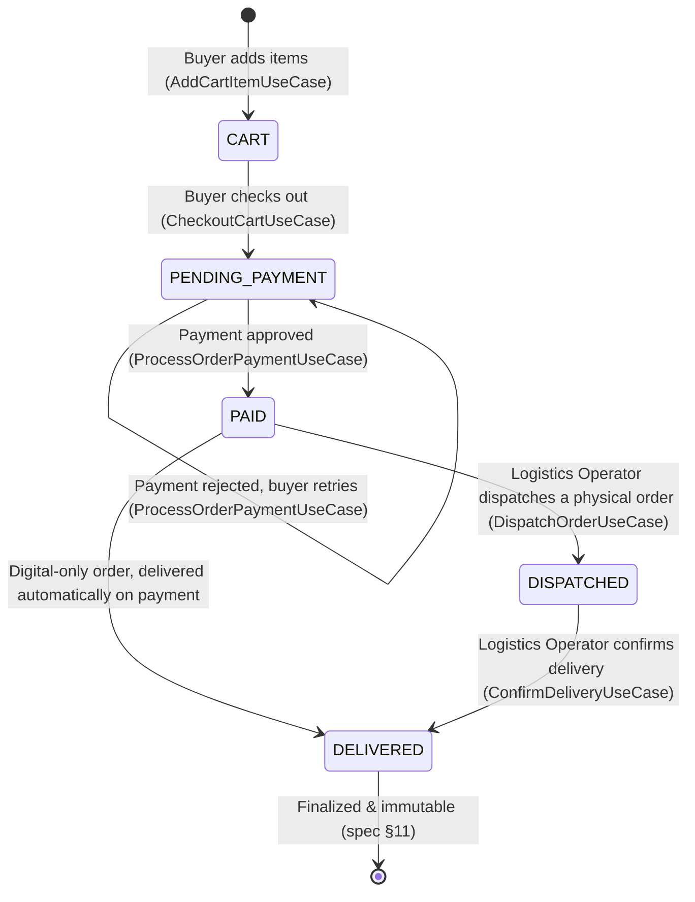

# Code Walkthrough & Role Flows

## 1. Purpose and Scope

This document explains **how the current codebase actually works**, end to end, and
traces **what each role does in the system**, starting from authentication. It
complements the per-subdomain SDD files (which specify *contracts and rules*) with a
narrative walkthrough of *how the pieces call each other* and *what a user's journey
looks like*.

Read this together with:

- [`SDD/Software Architecture/Software Architecture.md`](Software%20Architecture/Software%20Architecture.md) — layer rules.
- [`SDD/domain/Domain Model.md`](domain/Domain%20Model.md) — entities and relationships.
- [`SDD/domain/services/`](domain/services/) — per-subdomain service specs.
- [`ALIGNMENT_PLAN.md`](../ALIGNMENT_PLAN.md) — the phased plan this codebase follows.

---

## 2. Implementation Status (Phases 1–7 Complete)

All 7 phases of the implementation plan are complete and tested:

| Layer | Status | Where |
| ----- | ------ | ----- |
| Domain models, Value Objects, exceptions | Built & tested | `application.domain.{models,valueobjects,enums,exceptions}` |
| Domain services (business logic) | Built & tested | `application.domain.services.*` (48 classes) |
| Input Ports (use-case contracts) | Built | `application.domain.ports.in` (35 interfaces) |
| Output Ports (contracts to the outside) | Built | `application.domain.ports.out` (16 interfaces) |
| Persistence adapters (MySQL / MongoDB) | Built & tested | `application.adapters.out.persistence.{mysql,mongodb}` |
| `PaymentGatewayPort` adapter (payment simulation) | Built & tested | `application.adapters.out.payment.SimulatedPaymentAdapter` |
| `NotificationPort` adapter (log simulation) | Built & tested | `application.adapters.out.notification.EmailNotificationAdapter` |
| `BusinessConfigurationPort` adapter | Built & tested | `application.adapters.out.config.PropertiesConfigurationAdapter` |
| `PasswordServicePort` / `JwtServicePort` adapters | Built & tested | `application.infrastructure.security.{BCryptPasswordAdapter,JjwtAdapter}` |
| Login / authentication (`LoginService`, `SecurityConfig`, JWT filter) | Built & tested | `application.domain.services.user.LoginService`, `application.infrastructure.security.*` |
| REST controllers, DTOs, mappers, OpenAPI | Built & tested | `application.adapters.in.rest.*`, `application.infrastructure.config.OpenApiConfig` |
| Schedulers & bootstrap data seeder | Built & tested | `application.adapters.in.scheduler.OrderExpirationScheduler`, `application.infrastructure.config.DataSeeder` |

You can run `./mvnw test` without external infrastructure, or run `./mvnw spring-boot:run` against local MySQL and MongoDB instances.

---

## 3. High-Level Architecture



Dependencies always point **toward the domain**. Nothing in `application.domain.*`
imports Spring Web, JPA, MongoDB or a JWT library — the only Spring dependency is the
`@Service` stereotype used for wiring.

---

## 4. Building Blocks Recap

A one-paragraph refresher per package (full detail in the linked SDD files):

- **`models/`** — `Person → User / Buyer / Seller`, `Product → PhysicalProduct /
  DigitalProduct`, plus `Category`, `ProductVariant`, `Warehouse`, `InventoryItem`,
  `InventoryMovement`, `Cart`/`CartItem`, `Order`/`OrderItem`, `Operation`, `AuditLog`,
  `Notification`. Relationships are object references, never IDs. See
  [Domain Model](domain/Domain%20Model.md).
- **`valueobjects/`** — `DomainCatalog` (code/name/description, equality by code) and
  its 12 catalogs (`UserRole`, `OrderStatus`, `InventoryItemCondition`, …), plus
  `Money`/`Email`/`DocumentId`/`StockQuantity` as validating `record`s. See
  [Domain Value Objects](domain/Domain%20Value%20Objects.md).
- **`exceptions/`** — `DomainException` (base) and 8 specific subtypes
  (`UnauthorizedOperationException`, `NegativeStockException`,
  `InvalidReservationException`, `FinalizedOrderModificationException`, …).
- **`services/<subdomain>/`** — one class per use case, `@Service` +
  `@RequiredArgsConstructor`, implementing the matching Input Port. See
  [Domain Services](domain/Domain%20Services.md) and the 10 files in
  [`domain/services/`](domain/services/).
- **`ports/in`** — 33 use-case interfaces (`RegisterUserUseCase`,
  `CheckoutCartUseCase`, …). See [Input Ports](domain/Input%20Ports.md).
- **`ports/out`** — 16 interfaces the domain needs from the outside (repositories,
  `PaymentGatewayPort`, `NotificationPort`, `PasswordServicePort`, `JwtServicePort`,
  `BusinessConfigurationPort`). See [Output Ports](domain/Output%20Ports.md).

---

## 5. Authentication Today vs. the Planned Login (Phase 6)

### Why there is no `LoginService`

Authentication is an **infrastructure concern** (spec explicitly excludes
"mecanismos de autenticación técnica" from scope), so it was placed in Phase 6 —
after security and REST adapters exist. Today the domain only *assumes* a `User` has
already been authenticated: every command service takes a `User requester` (or
`Buyer buyer`) parameter and immediately validates it:

```java
validateUserStatusService.execute(requester);              // is it ACTIVE? (RG01)
validateRoleAuthorizationService.execute(requester, ...);   // does it have the right role? (§12)
```

Two output ports already exist for this reason, but have **no implementation and no
login consumer yet**:

- `PasswordServicePort` — `encrypt(raw)` / `matches(raw, encoded)`.
- `JwtServicePort` — `generateToken(User user)`.

`RegisterUserService`, `RegisterBuyerService` and `OnboardSellerService` already call
`PasswordServicePort.encrypt(...)` when creating a user, so a password is hashed at
registration time — but nothing today verifies a password back, because there is no
login endpoint.

### The `User` ↔ `Buyer`/`Seller` identity bridge

`User`, `Buyer` and `Seller` all extend `Person` independently — none references
another. Early on, only `RegisterUserService` created a `User`; `RegisterBuyerService`
and `OnboardSellerService` created only a `Buyer`/`Seller`, with no login credentials
at all. That was fixed: **both now also create a `User`** (via `UserRepositoryPort` +
`PasswordServicePort`), copying the buyer's/seller's identity onto it, so every
participant that can act in the system also has a login row. The join key is
`DocumentId` — the same `identification` value on both rows — which is safe to rely on
because `ValidatePlatformUniquenessService` (see below) guarantees it is unique across
`User`, `Buyer` and `Seller` combined. Phase 6's login flow will authenticate the
`User` first, then resolve the matching `Buyer`/`Seller` profile via
`findByIdentification` when the endpoint needs one.

### Platform-wide uniqueness (spec §11)

Document and e-mail uniqueness used to be checked **per repository** — a
`RegisterUserService` call only asked `UserRepositoryPort`, so the same document could
be registered as a `User`, a `Buyer` **and** a `Seller` without collision. This is now
enforced by `ValidatePlatformUniquenessService` (`application.domain.services.identity`),
which every registration/onboarding service calls before persisting: it checks
`UserRepositoryPort`, `BuyerRepositoryPort` **and** `SellerRepositoryPort` together.

### The planned login flow (Phase 6 — not implemented)



After login, every subsequent request carries `Authorization: Bearer <token>`. A
planned JWT filter decodes it into a `User` (`username`, `role`) and hands it to the
controller, which passes it as the `requester` argument into the Input Port — exactly
the parameter every service already expects today.



---

## 6. Role-by-Role Flows

Every flow below starts at **"(planned) Login"** because that is where it will start
once Phase 6 exists. The steps after it are **real, implemented, unit-tested**
services you can find under `src/main/java/application/domain/services/`.

### 6.1 Buyer

No prerequisite — a buyer creates its own account.



**Step by step**

1. **Register** — `RegisterBuyerUseCase.register(buyer, account)` →
   `RegisterBuyerService`. Validates `mainAddress` and that `account` carries a
   username/password; `ValidatePlatformUniquenessService` checks the document and
   e-mail are unique **across `User`, `Buyer` and `Seller` combined**
   (`DuplicateUserException` otherwise, spec §11); sets `role = BUYER`,
   `commercialStatus = ACTIVE`; persists the `Buyer`, then persists `account` as a
   `User` sharing the same identity (password encrypted via `PasswordServicePort`) —
   this is the identity that will later log in. No authentication needed for this
   step itself.
2. **(Planned) Login** → obtains a JWT with `role = BUYER`.
3. **Browse the catalog** — `ConsultCatalogUseCase.consultPublished()` →
   `ConsultCatalogService`. Public; no requester, no authorization check.
4. **Add to cart** — `AddCartItemUseCase.addItem(buyer, item)` →
   `AddCartItemService`. Runs `ValidateBuyerCanPurchaseService` (the buyer must be
   commercially `ACTIVE`), requires the product to be `PUBLISHED`, creates the
   `Cart` on first use.
5. **Manage the cart** — `RemoveCartItemUseCase`, `ClearCartUseCase`,
   `ConsultCartUseCase`. Not audited (low-significance, provisional data).
6. **Checkout** — `CheckoutCartUseCase.checkout(buyer)` → `CheckoutCartService`.
   Builds an `Order` from the cart lines, capturing `unitPrice` from each product at
   that moment. For every **physical** line, `ReserveStockForOrderItemService` picks
   a warehouse with enough `AVAILABLE` stock, decrements it, and records the
   reservation (`InvalidReservationException` aborts checkout if none has enough —
   spec §11); digital lines need no reservation. Then `CART → PENDING_PAYMENT`; the
   cart is marked `CONVERTED`; records `Operation(CART_CHECKOUT)`.
7. **Pay** — `ProcessOrderPaymentUseCase.pay(buyer, order)` →
   `ProcessOrderPaymentService`. `ValidateBuyerOwnsOrderService` first confirms the
   order belongs to the paying buyer (`UnauthorizedOperationException` otherwise —
   this used to be unchecked). Then calls `PaymentGatewayPort.process(order)` (the
   probabilistic approve/reject simulation will live in the Phase 5 adapter, not in
   this service). On rejection the order stays `PENDING_PAYMENT` and
   `PaymentRejectedException` is thrown so the buyer can retry step 7. On approval:
   `PAID`, and immediately `DELIVERED` if the order has no physical products; a
   confirmation `Notification` is sent through `NotificationPort`.
8. **Track orders** — `ConsultOrderUseCase.consult(requester, order)` and
   `ConsultBuyerOrdersUseCase.consultByBuyer(requester, buyer)`. Guarded by
   `ValidateOrderAccessService` and `ValidateBuyerOwnershipService` so a buyer only
   ever sees its own orders (spec RG03).
9. **Maintain the profile** — `UpdateBuyerUseCase` / `ConsultBuyerUseCase`, guarded
   by `ValidateBuyerOwnershipService` (self only).

A buyer never has a code path into seller, warehouse or inventory use cases — those
Input Ports simply take a different actor type or reject the `BUYER` role outright.

---

### 6.2 Seller

**Prerequisite: a seller cannot self-register.** It must be onboarded by an `ADMIN`
(spec Domain 3).



**Step by step**

1. **Onboarding (performed by an Admin, not the seller)** —
   `OnboardSellerUseCase.onboard(admin, seller, firstWarehouse, sellerAccount)` →
   `OnboardSellerService`. Requires an `ADMIN` requester; `sellerAccount` must carry
   credentials; `ValidatePlatformUniquenessService` checks the document and e-mail are
   unique **across `User`, `Buyer` and `Seller` combined** (spec §11); sets
   `role = SELLER`, `status = ACTIVE`, `onboardedBy = admin`; forces the warehouse to
   `type = SELLER` with `owner = seller`; persists `sellerAccount` as a `User` sharing
   the seller's identity — this is the identity the seller will later log in with;
   records `Operation(SELLER_ONBOARDING)`.
2. **(Planned) Login** → JWT with `role = SELLER`.
3. **Consult its own seller profile** — `ConsultSellerUseCase.consult(requester, probe)`
   → `ConsultSellerService`, guarded by `ValidateSellerOwnershipService` (allows self
   or `ADMIN`/`SUPERVISOR`).
4. **Publish a product** — `PublishProductUseCase.publish(seller, product)` →
   `PublishProductService`. Requires role `SELLER`; the caller decides
   `PhysicalProduct` vs `DigitalProduct`; sets `status = PUBLISHED`.
5. **Update a product** — `UpdateProductUseCase` → `UpdateProductService`, guarded by
   `ValidateProductOwnershipService` (a seller only touches its own products; an
   `ADMIN` may touch any).
6. **Change a product's status** — `ChangeProductStatusUseCase` →
   `ChangeProductStatusService` — same ownership guard.
7. **List its own products** — `ConsultSellerProductsUseCase.consultBySeller(requester, seller)`
   → `ConsultSellerProductsService`, guarded by `ValidateSellerOwnershipService`.
8. **Manage inventory** (shared responsibility with `LOGISTICS_OPERATOR`, spec §12) —
   `RegisterInventoryEntryUseCase`, `ReserveInventoryUseCase`,
   `ReleaseReservationUseCase`, `AdjustInventoryUseCase`,
   `RegisterInventoryReturnUseCase`, `ConsultInventoryUseCase`.

---

### 6.3 Logistics Operator

**Prerequisite:** registered as a plain `User` by an `ADMIN` (`RegisterUserUseCase`
with `role = LOGISTICS_OPERATOR`) — there is no separate onboarding flow like the
seller's; a logistics operator is an internal employee.



**Step by step**

1. **(Planned) Login** → JWT with `role = LOGISTICS_OPERATOR`.
2. **Consult warehouses** — `ConsultWarehouseUseCase` (allowed roles: `ADMIN`,
   `SUPERVISOR`, `LOGISTICS_OPERATOR`).
3. **Operate inventory** — the six inventory use cases a seller also uses
   (`RegisterInventoryEntry`, `ReserveInventory`, `ReleaseReservation`,
   `AdjustInventory`, `RegisterInventoryReturn`, `ConsultInventory`);
   `ReserveInventoryService` is where the spec §11 rules are enforced
   (`InvalidReservationException` for missing/`DAMAGED` inventory,
   `NegativeStockException` for over-reservation).
4. **Dispatch an order** — `DispatchOrderUseCase.dispatch(requester, order)` →
   `DispatchOrderService`. Only orders containing physical products can be
   dispatched; records a `SALE_EXIT` `InventoryMovement` for each physical line
   against its fulfillment `warehouse`; `PAID → DISPATCHED`; records
   `Operation(ORDER_DISPATCH)`.
5. **Confirm delivery** — `ConfirmDeliveryUseCase.confirmDelivery(requester, order)`
   → `ConfirmDeliveryService`. `DISPATCHED → DELIVERED`; the order becomes
   finalized and immutable (spec §11); records `Operation(ORDER_DELIVERY)`.
6. **Consult any order** — `ConsultOrderUseCase`; `ValidateOrderAccessService`
   grants `LOGISTICS_OPERATOR` access to every order, not just one buyer's.

---

### 6.4 Administrator

**Prerequisite / bootstrap problem:** `RegisterUserUseCase` itself requires an
`ADMIN` requester — including to create the *first* admin. There is no seed
mechanism yet (the original plan reserves a `DataSeeder` for Phase 7). Until then,
the first `ADMIN` has to be inserted directly, outside any use case. See
[§8](#8-known-gaps).



**Step by step**

1. **(Planned) Login** → JWT with `role = ADMIN`.
2. **User administration** — `RegisterUserUseCase` (any role, including other
   admins, logistics operators, supervisors), `ChangeUserStatusUseCase`
   (activate/block/deactivate), `ConsultUserUseCase`.
3. **Buyer administration** — `ChangeBuyerCommercialStatusUseCase`
   (`ACTIVE` / `SUSPENDED`), `ConsultBuyerUseCase`, `ConsultBuyerOrdersUseCase`.
4. **Seller administration** — `OnboardSellerUseCase` (seller + first warehouse in
   one flow), `ConsultSellerUseCase`, `ConsultSellerProductsUseCase`.
5. **Warehouse administration** — `RegisterWarehouseUseCase` (additional
   `MARKETPLACE` or `SELLER` warehouses, with type/owner consistency check),
   `ConsultWarehouseUseCase`.
6. **Catalog moderation** — `ChangeProductStatusUseCase` also accepts an `ADMIN`
   requester (`ValidateProductOwnershipService` allows `ADMIN` on *any* product, not
   just the requester's own).
7. **Audit oversight** — `ConsultAuditLogUseCase` → `ConsultAuditLogService`.

An `ADMIN` is the only role that can create other users and onboard sellers — every
other role in the system ultimately traces back to something an `ADMIN` did.

---

### 6.5 Supervisor

Read-only role ("perfil de consulta y seguimiento operativo", spec §5). Confirmed by
inspection: **no mutating service accepts `SUPERVISOR` in its
`ValidateRoleAuthorizationService` check** — it only ever appears alongside `ADMIN`
in `Consult*` services.



**Step by step**

1. **(Planned) Login** → JWT with `role = SUPERVISOR`.
2. Read-only access across the system: `ConsultUserUseCase`, `ConsultBuyerUseCase`,
   `ConsultBuyerOrdersUseCase`, `ConsultSellerUseCase`, `ConsultSellerProductsUseCase`,
   `ConsultWarehouseUseCase`, `ConsultInventoryUseCase`, `ConsultOrderUseCase`
   (any order, via `ValidateOrderAccessService`), `ConsultAuditLogUseCase`.
3. No write path exists for this role by design.

---

## 7. Order Lifecycle Across Roles



Enforcement lives in the `Order` model itself (`Order.transitionTo(...)`,
`Order.addItem(...)`), not in the services — so no service can accidentally move an
order through an illegal path or mutate a `DELIVERED` order.

---

## 8. Resolved Gaps Across Phases 1–7

**Resolved in the domain layer (Phases 1–4):**

- Document/e-mail uniqueness (spec §11) is checked **across `User`, `Buyer` and
  `Seller` together** via `ValidatePlatformUniquenessService`, and `username`
  uniqueness is checked across all registration flows (`RegisterUserService`,
  `RegisterBuyerService`, `OnboardSellerService`).
- `RegisterBuyerService` and `OnboardSellerService` also create a linked login
  `User` (§5 above), closing the identity-bridge gap.
- `ProcessOrderPaymentService` calls `ValidateBuyerOwnsOrderService` — a buyer can
  only pay for its own order.
- `CheckoutCartService` reserves inventory for every physical line through
  `ReserveStockForOrderItemService`, setting `OrderItem.warehouse`.
- `DispatchOrderService` records per-item `SALE_EXIT` `InventoryMovement`s for each
  physical line against its fulfillment warehouse.
- `RegisterInventoryReturnService` (`RegisterInventoryReturnUseCase`) records
  `RETURN` inventory movements and `INVENTORY_RETURN` operations.
- `ChangeBuyerCommercialStatusService` (`ChangeBuyerCommercialStatusUseCase`) lets an
  `ADMIN` activate or suspend a buyer's commercial status.
- `ConsultSellerService` allows a `SELLER` to consult its own seller profile via
  `ValidateSellerOwnershipService`, and `ConsultSellerProductsService` /
  `ConsultBuyerOrdersService` expose seller product portfolios and buyer order
  histories.

**Resolved in the adapters & infrastructure layers (Phases 5–7):**

1. **All 16 output ports implemented (Phase 5 & 6).** MySQL JPA adapters (`persistence.mysql.adapters`), MongoDB audit adapter (`AuditLogMongoAdapter`), payment gateway simulator (`SimulatedPaymentAdapter`), notification adapter (`EmailNotificationAdapter`), configuration adapter (`PropertiesConfigurationAdapter`), password hashing (`BCryptPasswordAdapter`), and JWT adapter (`JjwtAdapter`).
2. **`@SpringBootTest` enabled (Phase 6).** `NexusMarketApplicationTests` verifies full Spring context wiring.
3. **Authentication, Security & REST API (Phase 6).** `LoginService`, `SecurityConfig`, `JwtAuthenticationFilter`, `AuthenticatedUserResolver`, 10 REST controllers, and OpenAPI/Swagger configuration (`OpenApiConfig`).
4. **Bootstrap `ADMIN` seeder and order-expiration scheduler (Phase 7).** `DataSeeder` (`CommandLineRunner`) idempotently seeds the initial `ADMIN` user on startup, and `OrderExpirationScheduler` periodically invokes `ReleaseExpiredOrdersUseCase` (`ReleaseExpiredOrdersService`) to release reserved physical stock on expired `PENDING_PAYMENT` orders.

---

## 9. Quick Reference: Role → Primary Use Cases

| Role | Can do | Cannot do |
| ---- | ------ | --------- |
| **Buyer** | Register itself, browse catalog, manage its own cart, checkout, pay (with retry), consult/list its own orders, update/consult its own profile | Anything with sellers, warehouses, inventory, other buyers' data, or other orders |
| **Seller** | Consult its own seller profile, publish/update/change status/list its own products, operate inventory | Onboard itself, touch another seller's products or profile |
| **Logistics Operator** | Operate inventory, consult warehouses, dispatch orders (logging `SALE_EXIT`), confirm delivery, consult any order | Manage users, sellers, warehouses (creation), or the catalog |
| **Administrator** | Register/change status of any user, change buyer commercial status, onboard/consult sellers, register/consult warehouses, moderate any product's status, consult audit log | — (superuser for management, but still subject to `ValidateUserStatusService`) |
| **Supervisor** | Consult users, buyers, sellers, warehouses, inventory, orders, audit log | Any mutation, anywhere |
